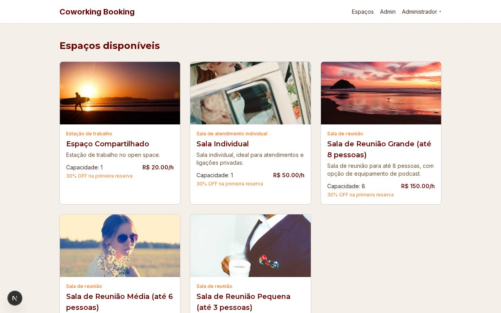
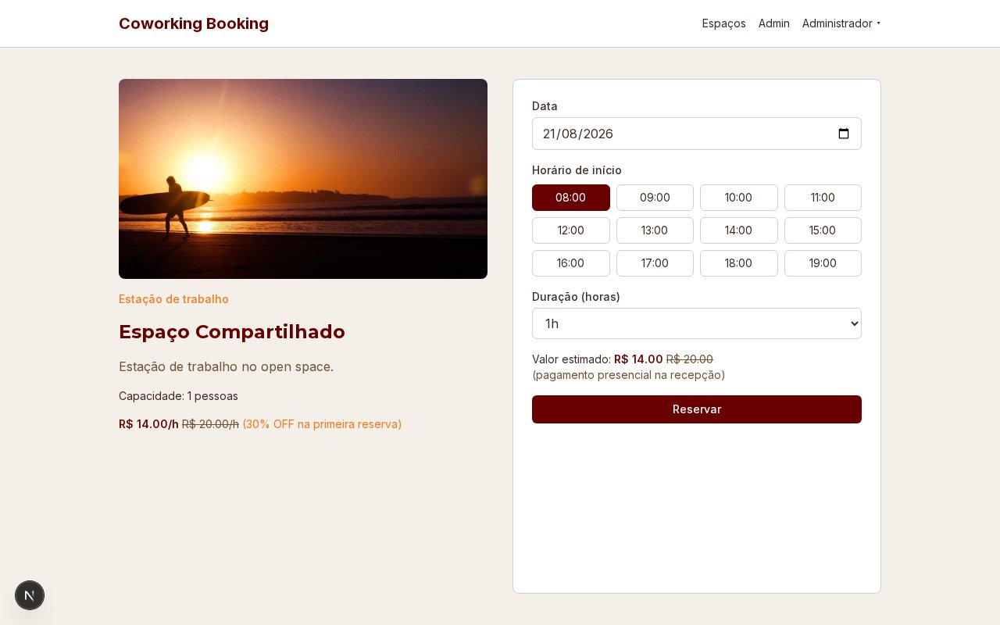
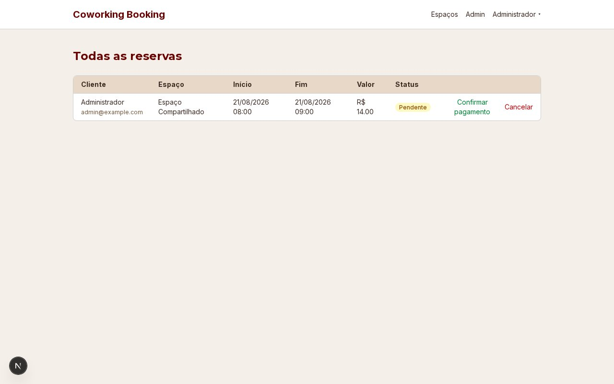

# 🏢 Cowork Booking

**English** · [Português](README.pt-BR.md)

[]()
[]()
[]()
[]()
[](LICENSE)

Booking system for a fictional coworking space: customers book rooms in real time, and the staff
manages spaces, bookings and payments from an admin panel.



## 🚀 Features

- **Sign-up and login** with e-mail and password or Google, with explicit LGPD (Brazilian data
  protection law) consent at sign-up
- **Real-time booking** by space, date and time, with automatic pricing and a welcome discount on
  the first booking
- **Overbooking prevention:** two people can never book the same slot, because the conflict check
  runs inside a `SERIALIZABLE` Postgres transaction
- **My bookings:** customer history, with free cancellation up to 24 hours before the start
- **Admin panel:** space CRUD, in-person payment confirmation and management of all bookings




## 🧠 Architecture Highlights

- **Backend and frontend split by folder** in a single Next.js app: `src/app/` and
  `src/components/` only handle UI; all business rules, auth and data access live in
  `src/backend/` (`services/`, `actions/`, `validations/`, `db/`). The frontend never touches the
  database directly, only through Server Actions.
- **Errors never leak to the user:** unhandled exceptions are caught, logged on the server and
  turned into a generic message; only explicit business messages (`SafeActionError`) reach the UI.
- **First-booking discount** is recalculated inside the same transaction that creates the booking,
  so concurrent clicks cannot grant it twice.
- **Validation everywhere:** every Server Action input goes through a Zod schema.

## 🛠️ Tech Stack

| Layer | Technology |
| --- | --- |
| Framework | Next.js 16 (App Router) + TypeScript |
| Styling | Tailwind CSS v4 |
| Database | PostgreSQL via Prisma 7 (`@prisma/adapter-pg`) |
| Auth | NextAuth.js v5 (Auth.js): credentials with bcrypt + Google OAuth |
| Validation | Zod |
| E-mail | Resend |
| Hosting | Vercel (app) + Neon (managed Postgres) |

## ⚙️ Running Locally

```bash
cp .env.example .env       # fill in the values
npm install
npx prisma dev -d          # starts a local Postgres managed by Prisma (once)
npx prisma migrate dev     # applies the schema
npx prisma db seed         # creates the admin user and sample spaces
npm run dev                # http://localhost:3000
```

Admin login created by the seed: `admin@example.com` / `admin123` (local use only).

## 📂 Project Structure

```text
├── prisma/               # schema, migrations and seed
└── src/
    ├── app/              # pages (App Router): spaces, bookings, profile, admin
    ├── components/       # UI components and forms
    └── backend/
        ├── actions/      # Server Actions (the only entry point from the UI)
        ├── services/     # business rules (bookings, spaces, e-mail)
        ├── validations/  # Zod schemas
        ├── auth/         # Auth.js config and guards
        └── db/           # Prisma client
```

## 🗺️ Roadmap

- Hour packages and WhatsApp notifications
- Occupancy and revenue reports in the admin panel
- Real photo upload for spaces and 2FA for admins
- Online payment gateway (Pix and card)

## 📄 License

[MIT](LICENSE)
